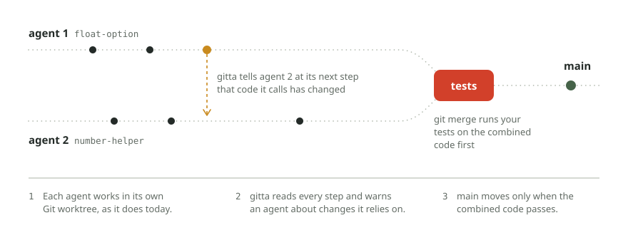

<p align="center">
  <a href="https://gitta.io">
    <picture>
      <source media="(prefers-color-scheme: dark)" srcset=".github/assets/wordmark-dark.svg">
      
    </picture>
  </a>
</p>

<h3 align="center">Many AI coding agents, one team.</h3>

<p align="center">
  Run several coding agents on one repository at once. gitta tells each agent when another one
  changes code it relies on, and tests every merge on the combined code before main moves.
</p>

```sh
curl -fsSL https://gitta.io/install.sh | sh
```

<p align="center">
  <a href="https://github.com/gitta-io/gitta/actions/workflows/ci.yml"></a>
  <a href="https://github.com/gitta-io/gitta/releases/latest"></a>
  <a href="LICENSE"></a>
  <a href="https://gitta.io/docs/agents.html"></a>
</p>

<p align="center">
  <a href="https://gitta.io"><b>gitta.io</b></a> &nbsp;·&nbsp;
  <a href="https://gitta.io/docs/quickstart.html">Quick start</a> &nbsp;·&nbsp;
  <a href="https://gitta.io/docs/">Docs</a> &nbsp;·&nbsp;
  <a href="https://gitta.io/research/">Research</a> &nbsp;·&nbsp;
  <a href="https://github.com/gitta-io/gitta/releases">Releases</a> &nbsp;·&nbsp;
  <a href="https://gitta.io/enterprise">Enterprise</a>
</p>

<br>

<p align="center">
  <picture>
    <source media="(prefers-color-scheme: dark)" srcset=".github/assets/demo-dark.svg">
    
  </picture>
</p>

<p align="center"><sub>gitta stops the merge when the combined code fails its tests, and lets it through once the agent fixes its call.</sub></p>

## Why gitta

Coding agents rarely work alone, and Git only notices when two of them change the same lines. A change that one agent's new code relies on can merge cleanly and still break main. gitta catches that while the agents work, so their work fits before anyone merges it.

- **79.4%** of agent pull requests in a study of 2,807 GitHub repositories were open at the same time as another agent pull request in the same repository ([Xu, Subramanian and Karthik](https://arxiv.org/abs/2607.04697)).
- **1 in 4** overlapping agent pull request pairs stopped with a Git conflict when we replayed 733 of them.
- **1 clean merge** in that replay passed its tests on both sides and failed them once merged. Git let it through, and gitta flagged it before the merge.

The [research page](https://gitta.io/research/) shows how we measured it.

## Install

**macOS and Linux**

```sh
curl -fsSL https://gitta.io/install.sh | sh
```

The script picks the build for your system, checks its SHA-256 checksum and puts `gitta` in `~/.local/bin`.

**Homebrew**

```sh
brew install gitta-io/tap/gitta
```

**Windows**

In PowerShell:

```powershell
irm https://gitta.io/install.ps1 | iex
```

The script picks the x86_64 or arm64 build, checks its SHA-256 checksum, puts `gitta.exe` in `%LOCALAPPDATA%\gitta\bin` and adds that folder to your user `PATH`.

**From source**

```sh
cargo build --release --manifest-path gitta-cli/Cargo.toml
```

Run `gitta update` later to get the newest version.

## Quick start

Go to your repository and tell gitta how to run your tests. gitta calls this command the gate.

```sh
cd ~/src/your-repo
gitta init --gate "npm test"
```

That is the whole setup. Start your agents the way you always do. gitta finds every worktree by itself, whichever tool made it.

```sh
gitta watch             # see what gitta does, live
git merge agent-branch  # gitta runs the gate on the combined code first
```

You can also let gitta start the agents, one worktree per task.

```sh
gitta run --gate "npm test" --task "Add a dark mode" --task "Add a search box"
```

## How it works

<p align="center">
  <picture>
    <source media="(prefers-color-scheme: dark)" srcset=".github/assets/how-it-works-dark.svg">
    
  </picture>
</p>

Each agent keeps its own Git worktree. After every step an agent takes, gitta reads what changed and checks it against the work of the other agents. When one agent changes a function that another agent's new code calls, gitta runs the tests on both changes together and tells the second agent inside its own session. That agent fixes its code and tells you in one sentence what happened.

You merge with plain `git merge`, `git pull` or `git push`. gitta runs your gate on the combined code first. When the tests fail, main stays as it was, and the output names the failing test and its first error line. Read more on [how it works](https://gitta.io/docs/how-it-works.html).

## Features

- **Warnings inside the agent's session.** Claude Code hears from gitta through hooks, and Cursor and Codex through MCP tools. The message names the changed function, the file that calls it and the failing test.
- **Tested merges with plain Git.** `git merge`, `git pull` and `git push` run your tests on the combined code before main moves, so there is nothing new to learn.
- **Every worktree, from any tool.** gitta picks up each Git worktree in the repository by itself, whoever made it.
- **Reads your code.** Python, TypeScript and JavaScript, Go, Rust, Java, C#, Kotlin, C and C++.
- **Pull request checks.** The [GitHub Action](gitta-action) checks open pull requests against each other, so reviewers see which ones clash.
- **A clear record.** `gitta watch` shows each step live, and `.gitta/gitta.log` keeps the same story as plain lines. A merge that removes tests or weakens a security check is named in the merge output.
- **Safe agent workspaces on Linux.** [gitta-fs](gitta-fs) gives each agent a copy-on-write workspace, and [gitta-sandbox](gitta-sandbox) limits its file and network rights.
- **One team policy.** The gate and the rules live in `.gitta.toml`, committed with your code, so every machine and the CI check use the same ones.

## Works with

<picture>
  <source media="(prefers-color-scheme: dark)" srcset=".github/assets/works-with-dark.svg">
  
</picture>

gitta works with Claude Code, Cursor, Codex and any tool that makes Git worktrees, and with pull requests on GitHub. The [agents page](https://gitta.io/docs/agents.html) shows the setup for each one.

## Documentation

| Page | What you find there |
|---|---|
| [Quick start](https://gitta.io/docs/quickstart.html) | Set up gitta in a repository |
| [Agents](https://gitta.io/docs/agents.html) | Claude Code, Cursor, Codex and other tools |
| [Warnings](https://gitta.io/docs/warnings.html) | What each warning means and what the agent does next |
| [Pull requests](https://gitta.io/docs/pull-requests.html) | Check open pull requests against each other |
| [Commands](https://gitta.io/docs/commands.html) | Every command and option |

The full documentation is at [gitta.io/docs](https://gitta.io/docs/), and its source is in [`docs/pages`](docs/pages).

## Repository

| Folder | What it holds |
|---|---|
| [`gitta-cli`](gitta-cli) | The `gitta` command |
| [`gitta-core`](gitta-core) | Code reading and the cross-agent checks |
| [`gitta-fs`](gitta-fs) | Copy-on-write agent workspaces on Linux (FUSE) |
| [`gitta-sandbox`](gitta-sandbox) | Runs an agent with limited file and network rights on Linux (Landlock) |
| [`gitta-action`](gitta-action) | The GitHub Action for pull requests |
| [`gitta-ci`](gitta-ci) | The pull request check for GitLab and Azure DevOps |
| [`dist`](dist) | The install scripts and the Homebrew formula |
| [`sbom`](sbom) | Software and cryptography bills of materials for each release |
| [`docs`](docs) | The documentation source |

## Enterprise

[gitta Enterprise](https://gitta.io/enterprise) brings every agent on every machine together as one team, with a team server and mainframe languages.

## Contributing

Read [CONTRIBUTING.md](CONTRIBUTING.md) before you open a pull request. Report security problems privately to support@gitta.io, as [SECURITY.md](SECURITY.md) explains.

## Licence

gitta is licensed under the [Apache License 2.0](LICENSE).
