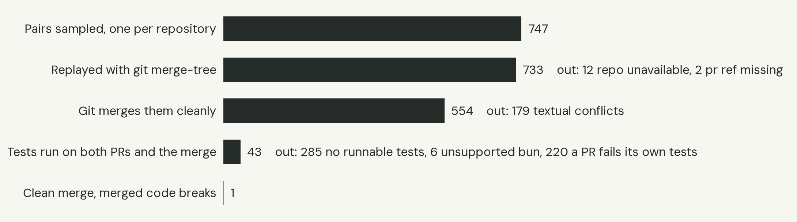
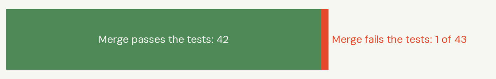
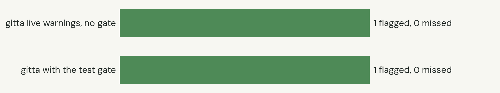
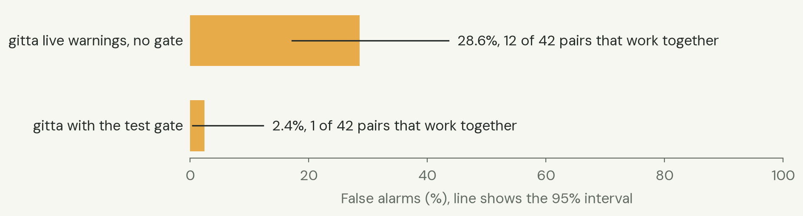
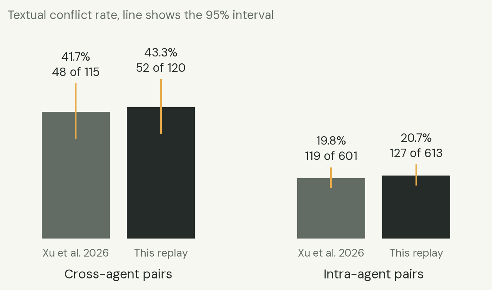
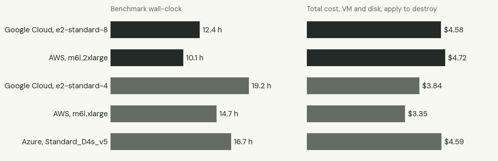

# Real agent pull request pairs: Git merges, tests and gitta

Replay of concurrent AI-agent pull request pairs from the AIDev dataset, following Xu et al. 2026 (arXiv 2607.04697). It measures how often Git merges two concurrent agent PRs cleanly while the merged code fails the project's own tests, and how many of those breaks `gitta pr-check` reports. The same inputs ran on Google Cloud, AWS and Azure.

## Rerun it

```sh
# needs terraform and an SSH key pair (SSH_KEY, default ~/.ssh/id_ed25519)
# gcp: gcloud logged in and GCP_PROJECT=<your project>; azure: az login; aws: AWS credentials (AWS_PROFILE if set)
GCP_PROJECT=<your project> VCPU=8 bench/aidev-replay/run.sh gcp all   # or aws / azure; VCPU=4 for the 4 vCPU tier
python3 bench/aidev-replay/analyze.py                                 # metrics.json and graphs/ (needs matplotlib)
```

`run.sh <cloud> all` does the whole run. It creates the VM with Terraform (`infra/bench/`, one workspace per cloud and tier), uploads the pinned inputs, builds gitta on the VM from `git archive` of the checked-out commit (or `GITTA_COMMIT`) and pulls the Docker images by digest. It then runs `runner.py` over `pairs.jsonl`, pulls `results-<cloud><vcpu>.jsonl` and the per-pair logs back, and runs `terraform destroy`. Last, it checks with the cloud CLI that nothing is left (`results/<run>/verify.txt`). The destroy runs from an exit trap, so it also happens when a step fails.

To rebuild the pair list from the dataset: `python3 build_pairs.py <AIDev v3 pull_request.parquet> pairs.jsonl`. This gives the identical file.

| Pinned input | Value |
|---|---|
| Dataset | Hugging Face `hao-li/AIDev`, tag `v3` (commit `3ca0045773097b138b064550dfd6e72229f40bee`), `pull_request.parquet` |
| Pair list | `pairs.jsonl`, 747 pairs, seed `20261020`, sha256 `3f222f066c5b4b608670bf33f6136daf576e6884e75e21528ee9747192dcdb70`. The base and head SHAs as fetched are in every `results-*.jsonl` row (`base`, `head_a`, `head_b`, `merge_tree`) and were identical on every cloud. |
| gitta | commit `e2dbbb0f51b455b3833ef842fbcd1511ef43bc18` (`gitta-core`, `gitta-cli`), built with Rust 1.90.0 `--locked` |
| Runner | `runner.py` sha256 `68639118d633a58270e34ca798dc73a8d6a75c16ec014e538914902168d072df` |
| Docker images | `images.json`: `python:3.12-bookworm@sha256:5560e9ab…`, `node:22-bookworm@sha256:0e5f9065…`, `golang:1.23-bookworm@sha256:167053a2…` |
| OS images | GCP `ubuntu-2404-noble-amd64-v20261016`; AWS `ami-0fd9576cca965bd19` (Canonical Ubuntu 24.04, eu-north-1); Azure `Canonical:ubuntu-24_04-lts:server:24.04.202610160` |
| Tool versions | per VM in `results/<run>/env.json` (OS, kernel, git, docker, rustc, gitta binary sha256, CPU) |

## Headline

Numbers from the Google Cloud 8 vCPU run. The other four runs (AWS 8, and GCP, AWS and Azure at 4 vCPU) give the same textual results and the same single break. Their small test differences come from flaky tests, explained under "Cloud comparison".

| What | Result |
|---|---|
| Textual conflict, cross-agent pairs | **43.3%** (52/120; 95% CI 34.8–52.3%). Paper: 41.7% (48/115) |
| Textual conflict, intra-agent pairs | **20.7%** (127/613; 95% CI 17.7–24.1%). Paper: 19.8% (119/601) |
| Git merges cleanly | 554 of 733 replayed pairs (75.6%) |
| Clean merges whose tests could be run on both PRs and on the merge | 43 |
| Of those, merged code breaks | **1 of 43** (2.3%; 95% CI 0.4–12.1%) |
| gitta live warnings (no gate) caught the break | 1 of 1 (95% CI 20.7–100%) |
| gitta with the test gate caught the break | 1 of 1 |
| gitta live warnings on pairs that work together (false alarms) | 12 of 42 (28.6%; 95% CI 17.2–43.6%). 5 of the 12 are only about docs or config files |
| gitta with the test gate, false alarms | 1 of 42 (2.4%). The one case is a flaky test (pterm); AWS had 0 of 43 |

**What the numbers support.** The paper's textual conflict rates replicate closely on its own dataset. The rate of "clean merge, broken code" in this sample is low: 1 in 43 pairs whose tests could run. The interval runs from 0.4% to 12%. One break supports no recall claim beyond "gitta caught the one real break we found". Do not publish a recall percentage from this run. Live warnings fire on about 3 in 10 pairs that work together.



## Method

1. **Dataset and co-activity.** On AIDev tag `v3` the PR table has exactly the AIDev-pop counts the paper reports: 33,596 PRs and 2,807 repos, and the same agent counts (Codex 21,799, Copilot 4,970, Devin 4,827, Cursor 1,541, Claude Code 459). Tags `v0.1` (7,122 PRs) and `v4` / `main` (71,677 PRs) do not match. Two PRs in one repo are co-active at k=0 when `[created_at, closed_at]` intervals overlap, with open PRs closed at the dataset cutoff. This reproduces the paper's prevalence numbers: 580,914 co-active pairs (paper 580,913), 1,129 repos, 26,691 PRs, 2,896 cross-agent pairs in 122 repos.
2. **Pairs.** One pair per repository, seeded (`20261020`): all 122 cross-agent repos (one random cross-agent pair each) and 625 intra-agent repos (one random intra-agent pair each). The 625 repos are drawn from the 1,007 repos that have intra-agent co-active pairs and no cross-agent pair. That gives 747 pairs, shuffled with the same seed. The list was built once and the same file uploaded to every VM.
3. **Textual replay.** In an empty repo: `git fetch --filter=blob:none origin refs/pull/A/head refs/pull/B/head`, `git merge-base`, then `git merge-tree --write-tree --name-only`.
4. **gitta, live.** `gitta pr-check --pr pra --other prb --base <merge-base> --json` on every replayed pair, 600 s limit. "Flagged" means any warning or "does not merge".
5. **Tests.** For pairs that merge cleanly, the runner checks out PR A, PR B and the merge commit (the `merge-tree` tree with both heads as parents) and runs the project's own tests in Docker. Each container gets 2 CPUs, 5 GB of memory, a pids limit and `no-new-privileges`. Dependencies are installed with networking on, then tests run with `--network none`. Detection covers only the repository root:
   - Node: a `test` script; `npm ci` / `npm install` / pnpm / yarn through corepack; then the `test` script, plus `tsc --noEmit` when a `tsconfig.json` and a local `tsc` exist.
   - Python: a test directory or test files; a venv with the requirements files, `-e .` plus `[test|tests|testing|dev]` extras and dependency groups, `setuptools pytest pytest-mock pytest-asyncio pytest-timeout`; then pytest.
   - Go: `go mod download`, then `go build ./... && go test ./...` with `GOPROXY=off`.
   - Bun-locked projects are recorded as unsupported.
   - Limits: 15 min for install and 15 min for tests.
6. **Break.** PR A and PR B pass, and the merge fails twice in a row (install or tests). A merge that fails once and then passes is "flaky" and counts as working. When the merge fails, the base is also tested, for context.
7. **gitta, gated.** On every pair that reached the merge test: `gitta pr-check … --gate "python3 runner.py gate $PWD"`. The gate runs the same Docker test routine on gitta's own combination on top of the merge base.
8. **Intervals.** 95% Wilson intervals.

Repository code never ran on the workstation. Git and gitta read the repositories on the VM; installs and tests ran only inside the containers.

### Where this differs from the paper

- **Intra-agent sampling.** The paper says stratum A has 625 repositories but not how they were chosen. We drew 625 at random from the 1,007 intra-only repos.
- **Exclusions.** Exclusions happen at fetch time today, not at the paper's time: 12 repos are gone or private, and 2 PR refs are missing. That gives 733 evaluable pairs (paper: 716 of 747). Our pairs are a different random draw, so the conflict counts differ while the rates agree.
- **Partial clones.** We fetch with `--filter=blob:none`; blobs load lazily during `merge-tree`.
- **Tests.** The test stage is new and not part of the paper.

### Changes during the run

- **First attempt.** The first attempt on each cloud (about 45 minutes, a few dozen pairs) was stopped. It showed harness gaps: corepack yarn and pnpm were shadowed by the image's yarn 1, and Python test extras and `setuptools` were missing. The runner was fixed and every cloud restarted from scratch with the same inputs. The aborted time is included in billed time and cost.
- **Azure workers.** Azure (4 vCPU) ran 1 pair at a time at first. Because that was projected to take more than 20 h, it was resumed after about 1.2 h with 2 pairs at a time, keeping finished results. Per-pair container limits stayed the same. The later GCP and AWS 4 vCPU runs used 2 pairs at a time from the start.

## Per-stage counts (GCP 8 vCPU)

| Stage | Pairs | Left out |
|---|---|---|
| Sampled | 747 | |
| Replayed (`merge-tree`) | 733 | 12 repo unavailable, 2 PR ref missing |
| Merged cleanly | 554 | 179 textual conflicts |
| Tests ran on both PRs and the merge | 43 | 285 no runnable tests at the root, 6 Bun (unsupported), 220 a PR fails its own tests* |
| Merge passes | 42 | |
| Merge breaks | 1 | |

\* For PR A of those 220: 135 tests fail, 48 installs fail, 26 tests time out, 4 installs time out, 4 have no tests collected, 3 pass (and PR B fails). Most are projects whose suites need services, browsers, other language versions, secrets or the network. One example is Karma needing Chrome system libraries.

The 43 evaluated pairs: 36 intra-agent and 7 cross-agent. By ecosystem: npm 13, Go 12, Python 7, pnpm 6, yarn 5.



## The break Git missed

Only one pair in the whole sample merged cleanly and broke, so there are not 3 to 5 examples to show.

**mendableai/firecrawl-mcp-server #72 + #73 (both Devin).** Base `d8e8d281f6cb`, heads `bf6e21e9646291a25ed3f3af7bb15cbcce3f5363` and `d8a14c3ea00f12b59fa956b79460fe77b6e63933`. Each PR passes `npm ci && npm test` alone, and so does the base. Git merges them without conflict. The merged `src/index.ts` then has two properties with the same name in one object literal, so the package's `prepare` build stops `npm ci`. It failed twice, on every cloud:

```
> firecrawl-mcp@1.11.0 build
> tsc && node -e "require('fs').chmodSync('dist/index.js', '755')"

src/index.ts(198,7): error TS1117: An object literal cannot have multiple properties with the same name.
npm error command sh -c npm run build
```

gitta live (no gate), from `pr-check --json`:

```
"warnings": ["both edited: src/index.ts assign SCRAPE_TOOL (#72 + #73)"], "merges": true
```

gitta with the gate: `"tests": "FAIL"`, with the same TS1117 output. It would post as "Breaks together with #73".



## False alarms

Live warnings on the 42 pairs whose merge passes the tests: 12 (28.6%). gitta reports "both edited" whenever both PRs touch the same file section or symbol. That is useful as a heads-up but is not a prediction that the code will break. Examples:

- getsentry/sentry-wizard #1040 + #1041: `both edited: CHANGELOG.md`
- vapourismo/knx-go #108 + #110: `both edited: .github/workflows/check.yaml`
- Skyscanner/turbolift #174 + #176: `both edited: internal/github/util_test.go def TestUserHasPushPermissionReturnsErrorForInvalidJSON` and two more test functions
- AfterShip/clickhouse-sql-parser #170 + #172: `both edited: parser/ast.go AliasExpr.def Accept`, `AlterRole.def Accept`
- microsoft/azure-devops-mcp #247 + #248: `both edited: src/tools/builds.ts def configureBuildTools`

5 of the 12 concern only docs or config files (README, CHANGELOG, workflow YAML, `package.json` and its lockfile, `docs/*.json`). With the gate, false alarms were 1 of 42 on GCP (a flaky timing test in pterm, which passed on AWS) and 0 of 43 on AWS.



## gitta and textual conflicts

- On 148 of the 168 git-conflicting pairs where gitta finished, gitta also reports "does not merge".
- On the other 20, gitta's structure-aware merge combines what line-based Git could not, for example `cmd/rqlited/main.go` in rqlite and `src/crewai/agent.py` in crewAI. We did not test whether those combinations build.
- gitta never reports "does not merge" on a pair that Git merges cleanly (0 of 542).
- `pr-check` hit the 600 s limit on very large repositories: 23 pairs on GCP and 18 on AWS (16 of them on both), for example microsoft/vscode, ray-project/ray, vllm-project/vllm, oven-sh/bun and dotnet/macios. Lazy blob fetching makes those slow. None of them reached the test stage, so the recall and false-alarm numbers are unaffected.



## Cloud comparison

| Run | Instance | vCPU / RAM | $/h VM + 200 GB disk | Benchmark wall-clock | Billed (apply to destroy) | Cost | Replayed / conflicts / evaluated / breaks | Live recall | Live false alarms | Gated false alarms |
|---|---|---|---|---|---|---|---|---|---|---|
| Google Cloud 8 | e2-standard-8, europe-north1-a | 8 / 32 GB | 0.2951 + 0.0512 | 12.4 h | 13.2 h | $4.58 | 733 / 179 / 43 / 1 | 1/1 | 12/42 | 1/42 |
| AWS 8 | m6i.2xlarge, eu-north-1b | 8 / 32 GB | 0.4080 + 0.0229 | 10.1 h | 11.0 h | $4.72 | 733 / 179 / 44 / 1 | 1/1 | 13/43 | 0/43 |
| Google Cloud 4 | e2-standard-4, europe-north1-a | 4 / 16 GB | 0.1476 + 0.0512 | 19.2 h | 19.3 h | $3.84 | 733 / 179 / 42 / 1 | 1/1 | 10/41 | 1/41 |
| AWS 4 | m6i.xlarge, eu-north-1b | 4 / 16 GB | 0.2040 + 0.0229 | 14.7 h | 14.8 h | $3.35 | 733 / 179 / 44 / 1 | 1/1 | 13/43 | 0/43 |
| Azure 4 | Standard_D4s_v5, swedencentral | 4 / 16 GB | 0.2040 + 0.0573 | 16.7 h | 17.6 h | $4.59 | 733 / 179 / 45 / 1 | 1/1 | 13/44 | 0/44 |
| Azure 8 | Standard_D8s_v5 | 8 / 32 GB | 0.408 + 0.0573 | not run | | | | | | |

Azure 8 vCPU did not run because the Azure vCPU quota available to us was 4 in the EU regions. Azure ran at 4 vCPU, and GCP and AWS also ran a 4 vCPU tier with the same inputs for a like-for-like comparison.

Columns:
- Benchmark wall-clock runs from the start of the (restarted) runner to its end. 8 vCPU runs use 3 pairs at a time, 4 vCPU runs 2.
- Billed time runs from `terraform apply` to the end of `terraform destroy`. It includes VM creation, setup, the aborted first attempt (8 vCPU and Azure only) and the pull of results.
- Cost is billed time × on-demand list price for VM and 200 GB SSD. GCP's E2 has no sustained-use discount. Network egress is not included.



**Differences between the clouds.** Every pair has the same base, head and merge-tree SHAs on every cloud, and the textual results are identical. All differences come from timing:

- **gitta 600 s timeout.** Between the two 8 vCPU runs, the live check on 9 very large repositories finished on one cloud and not on the other: it finished only on AWS for vscode, ray, vllm, bun, mautic, sakai and netcap, and only on GCP for dotnet/macios and sst/opencode.
- **pterm/pterm** (pair 253): one test is timing-dependent. PR A failed it on AWS, so the pair is excluded there and evaluated as working on GCP. On GCP the same flake made the gated check fail (GCP's one gated false alarm).
- **primer/react #6076 + #6081** (pair 161): 3 of 1,457 Jest tests failed for PR A on GCP and all passed on AWS. The pair is evaluated as working on AWS only.
- **tinacms/tinacms** (pair 401): the turbo build-and-test failed on both PRs on GCP (6.3 min) and passed on AWS (3.1 min).
- **microsoft/azurelinux** (pair 179): checking out the very large tree failed on GCP; AWS found no runnable tests.

**The 4 vCPU runs** add the same kind of noise. Compared with GCP 8 vCPU:
- AWS 4 matches AWS 8 except for gitta timeouts and one more pair (JuliaLang/julia #522, a checkout failure).
- Azure 4 also has serviceradar, whose Go tests failed on GCP 8 (240 s) and passed on Azure (120 s), and two lazy-fetch checkout failures (microsoft/sbom-tool, DaveSkender/Stock.Indicators).
- GCP 4 has four pairs whose tests flaked or timed out on the slower machine: gitlab-ci-pipelines-exporter, agentops, assistant-ui and serviceradar.

On every one of the five runs, all of these match exactly: 733 replayed pairs, 179 textual conflicts (127/613 intra-agent, 52/120 cross-agent), the one break, and gitta catching it both live and with the gate. The number of evaluated pairs varies between 41 and 45 because of the flaky tests above. Live false alarms range from 10/41 to 13/44 (24–30%). Gated false alarms are 0 or 1, the one being the pterm flake on GCP.

The single break (firecrawl-mcp-server) and gitta's result on it are the same on every cloud.

Price sources, looked up 2026-10-20:
- GCP: Cloud Billing Catalog API, Compute Engine SKUs "E2 Instance Core running in Finland" $0.02401614/vCPU-h, "E2 Instance Ram running in Finland" $0.00321816/GiB-h, "SSD backed PD Capacity in Finland" $0.187/GiB-month. Public pages: https://cloud.google.com/compute/vm-instance-pricing and https://cloud.google.com/compute/disks-image-pricing.
- AWS: public price list `https://pricing.us-east-1.amazonaws.com/offers/v1.0/aws/AmazonEC2/current/eu-north-1/index.csv`: m6i.2xlarge $0.408/h, m6i.xlarge $0.204/h (Linux, on demand), gp3 $0.0836/GB-month. Public page: https://aws.amazon.com/ec2/pricing/on-demand/.
- Azure: Retail Prices API `https://prices.azure.com/api/retail/prices`, swedencentral: Standard_D8s_v5 $0.408/h, Standard_D4s_v5 $0.204/h (Linux), P15 Premium SSD managed disk $41.81/month. Public page: https://azure.microsoft.com/pricing/details/virtual-machines/linux/.

## Limitations

- **Few pairs reach the test stage.** Only 43 of 554 clean merges could be tested, about 8%. Most projects have no root-level test command we can run offline in a stock container, or their PRs already fail their own tests there. The break rate applies to this testable subset. Projects with heavier test setups may break more or less often.
- **Tests miss breaks.** A break counts only when the project's tests catch it, at the repository root only. Semantic breaks that the tests do not cover are invisible here, as they are to CI.
- **One break.** With a single break, recall cannot be estimated; the interval is 21–100%.
- **The paper's selection.** We could not recover how the paper picked its 625 intra-agent repositories, or which pairs it drew.
- **Age.** PR refs and repositories are fetched as they are today, not at the time the PRs were open. Closed PRs keep their head refs, but deleted repositories drop out (12).
- **gitta timeouts.** 15 to 25 very large repositories, depending on the machine, hit gitta's 600 s limit. They all fall outside the test stage.

## Files

- `REPORT.md`: this report. `metrics.json`: all metrics per run. `cross_cloud_diffs.json`: pair-level differences against GCP 8 vCPU.
- `results-<cloud><vcpu>.jsonl`: one row per pair with stage, SHAs, test status, gitta live and gated JSON, and timings. Test output tails are left out of the published rows; `run.sh` keeps them, and the full per-pair logs, under `results/<run>/` on your own run.
- `results/<run>/`: timeline, `env.json`, `machine.json`, `verify.txt` and the start and end times that `analyze.py` reads.
- `build_pairs.py`, `pairs.jsonl`, `runner.py`, `vm-setup.sh`, `images.json`, `run.sh`, `analyze.py`, `fonts/` (DM Sans, OFL). Terraform: `../../infra/bench/`.
- `graphs/`: SVG and PNG.
