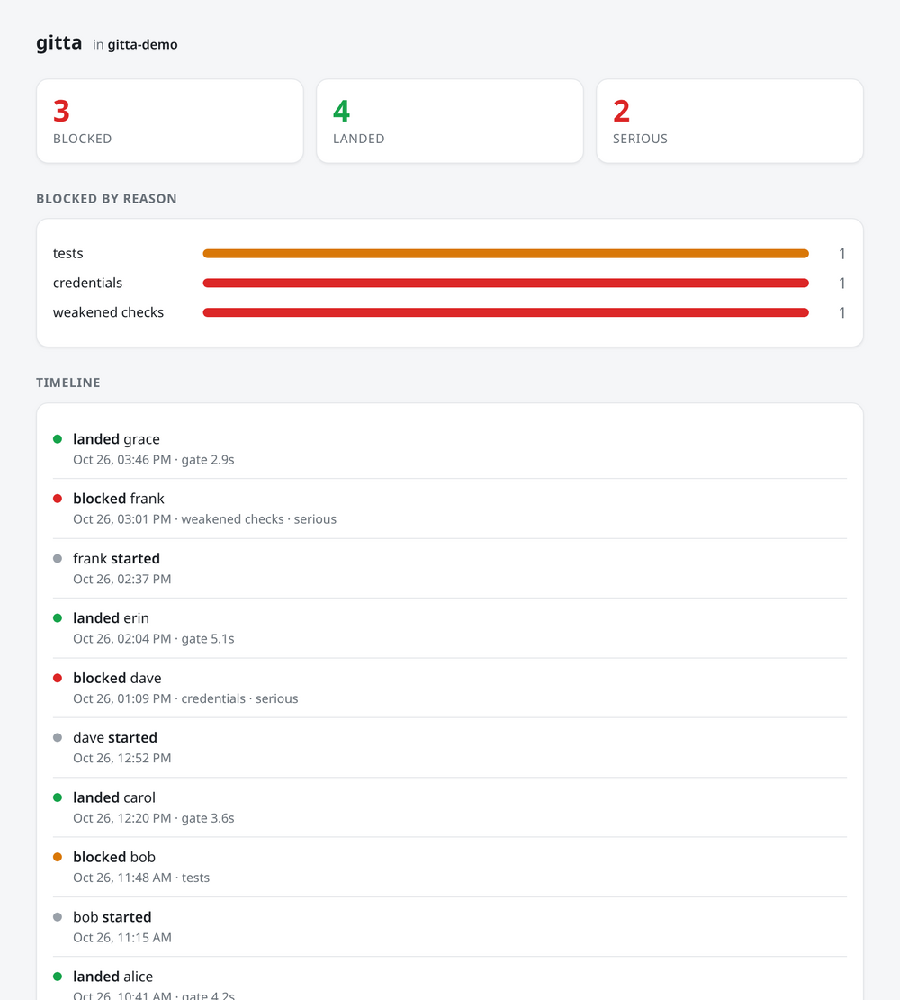

# gitta integrations

One event stream, many frontends — show what gitta is doing wherever you already
look.

gitta writes `.gitta/audit.jsonl` in every repo it manages: one hash-chained JSON
object per event (`landed`, `land_refused`, `agent_started`, …), each carrying the
gate command, its result and seconds. These scripts only **read** that file. They
never run the gitta binary, so they are agnostic to the editor, agent or AI
frontend driving gitta — the same stream feeds a status bar, a terminal, an
editor or a notifier equally, and polling is cheap and safe.

They all show gitta's **impact**, not its plumbing: how many merges it **blocked**
(bad code kept off the branch) next to how many passed and **landed**. Blocked and
landed are coloured differently — a block is an alert, a landing is good — and a
serious block (credentials, security, weakened checks, policy) is called out in
red with a ⚠.


## What's here

- **`gitta-feed`** — the core. Emits a neutral JSON summary
  (`{on, landed, blocked, serious, by_check, last}`) for one repo. Every other
  script formats this, so they never re-parse the trail.
- **`waybar/`** — a [Waybar](https://github.com/Alexays/Waybar) module (its own
  README; colours and glyphs are configurable).
- **`gitta-tmux`** — a tmux `status-right` segment.

  
- **`gitta-i3blocks`** — a block for **swaybar** (sway) and **i3bar** (i3), via
  [i3blocks](https://github.com/vivien/i3blocks).
- **`gitta-notify`** — a one-shot status line; `--toast` also calls `notify-send`.
- **`gitta-dashboard`** — generates a self-contained HTML page (tiles, a
  blocked-by-reason chart and a timeline) from the trail. No server.

  
- **`sample-audit.jsonl`** — a sample trail to try any of them against.

## Use

Each takes a repo path (an argument, `$GITTA_REPO`, or the current directory) and
needs `jq`:

```sh
./gitta-feed ~/src/myrepo
./gitta-dashboard ~/src/myrepo > dashboard.html
```

Try them against the sample without a real repo:

```sh
mkdir -p /tmp/demo/.gitta && cp sample-audit.jsonl /tmp/demo/.gitta/audit.jsonl
./gitta-tmux /tmp/demo
```

Writing another frontend is a few lines: call `gitta-feed`, format its JSON.

## A cleaner read, later

Today these read the audit trail directly. A `gitta status --json` with
cumulative counts, or an atomically-rewritten `.gitta/status.json`, would let a
consumer read current state without walking the chain.
